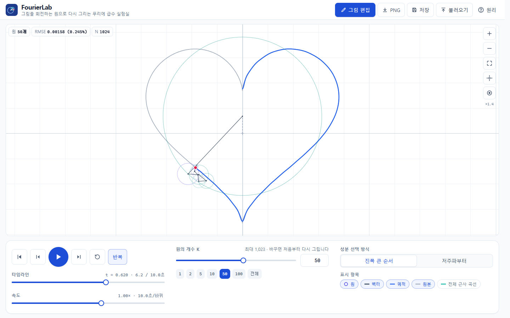
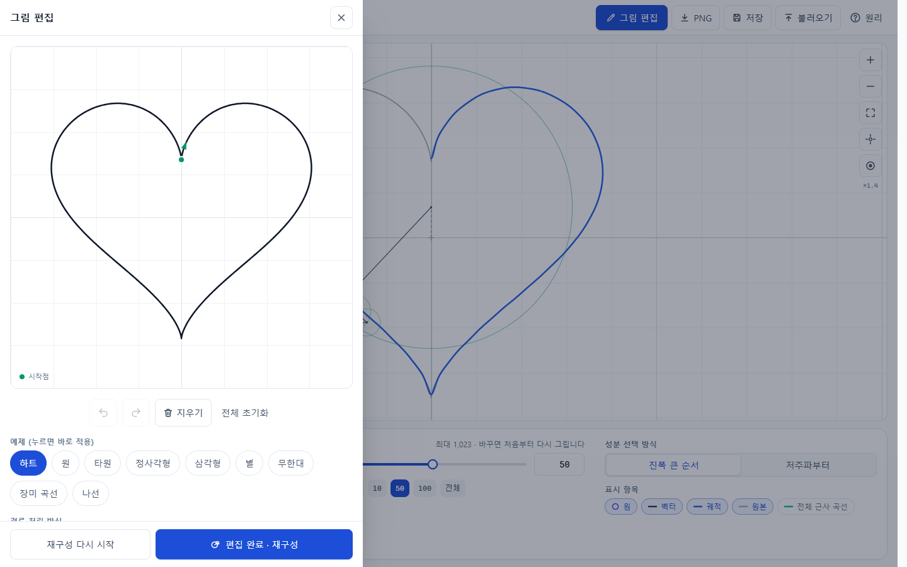
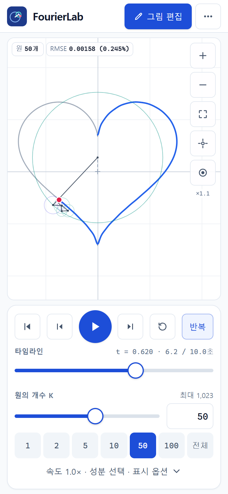
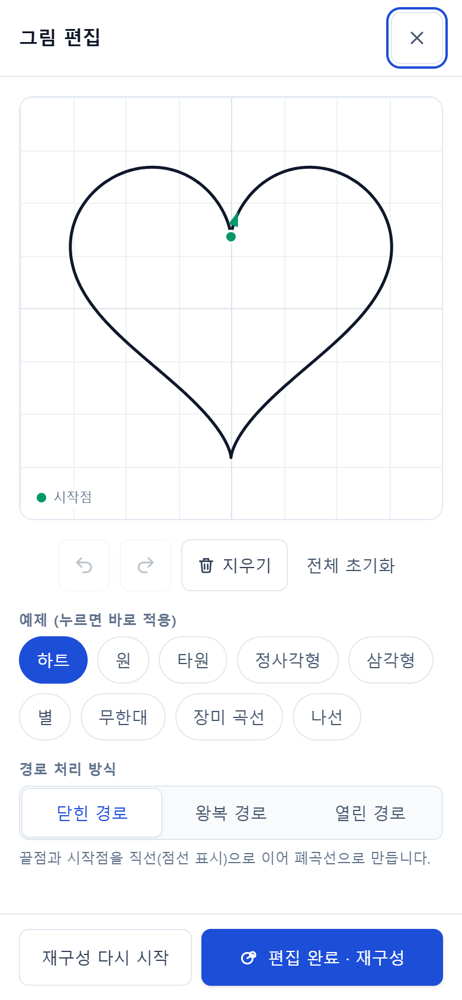
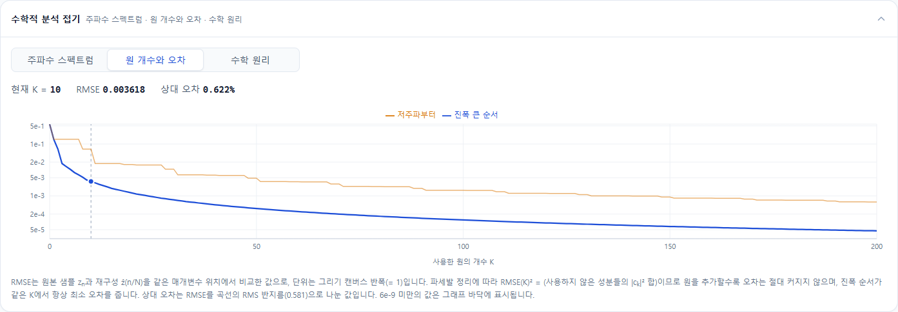

# FourierLab

**직접 그린 그림을 푸리에 급수와 회전하는 원으로 재구성하며 수학적 원리를 탐구하는 인터랙티브 시각화 실험실**

마우스나 손가락으로 선을 하나 그리면 FourierLab이 그 선을 복소 푸리에 급수로 분해합니다. 그다음 여러 개의 회전하는 원(에피사이클)을 머리와 꼬리가 이어지도록 연결해, 마지막 원의 끝점이 그림을 다시 그려 내도록 합니다. 원의 개수, 속도, 성분 선택 방식을 바꾸면서 근사가 어떻게 정확해지는지 직접 실험할 수 있습니다.

## Live Demo

**https://oyueo-mm.github.io/FourierLab/**



## 화면 구성

메인 화면은 회전하는 원의 애니메이션이 대부분을 차지합니다. 그림 그리기는 필요할 때만 여는 **편집 드로어**로 옮겼습니다.

| 데스크톱 편집 드로어 | 모바일 첫 화면 | 모바일 편집 (전체 화면) |
|---|---|---|
|  |  |  |

- **메인**: 간결한 헤더(그림 편집 · 이미지 업로드 · PNG · 저장 · 불러오기 · 사이드바 토글) + 화면 대부분을 차지하는 에피사이클 캔버스 + 오른쪽 접이식 사이드바(재생 · 타임라인 · 속도 · 원 개수 · 성분 선택 · 표시 항목, 접이식 「고급 설정」과 「수학적 분석」)
- **그림 편집**: 헤더의 「그림 편집」 버튼으로 엽니다. 데스크톱에서는 왼쪽에서 열리는 약 576px 드로어(그림 캔버스 약 540px), 모바일에서는 전체 화면입니다.
- **사이드바**: 데스크톱(1024px 이상)에서는 약 360px 폭으로 캔버스와 공간을 나누고, 닫으면 캔버스가 넓어집니다. 열고 닫아도 재생 위치와 설정은 바뀌지 않습니다. 태블릿·모바일에서는 오른쪽에서 밀려 나오는 오버레이이며, 캔버스 아래의 간단한 재생 바(재생·단계 이동·설정)로 핵심 기능에 바로 접근합니다.
- **이미지 업로드**: 헤더의 「이미지 업로드」, 편집기의 「이미지」 탭, 드래그 앤 드롭, 붙여넣기(Ctrl+V)로 PNG/JPG/WebP를 올리면 브라우저 안에서 윤곽선을 추출해 기존 푸리에 엔진으로 재구성합니다. 이미지는 서버로 전송되지 않으며, 저장되는 것은 추출한 경로(좌표)뿐입니다. 색·채움은 반영되지 않고 선택한 윤곽선 하나만 재구성합니다.

## 주요 기능

**원 개수를 바꾸면 처음부터 다시 그립니다**
- 원 개수(슬라이더·직접 입력·빠른 선택)와 성분 선택 방식을 바꾸면 궤적을 지우고 t = 0에서 새 근사 결과를 다시 그립니다.
  - 재생 중: 바로 처음부터 다시 재생합니다.
  - 일시정지 중: 처음 프레임을 보여 주고 정지 상태를 유지합니다.
  - 한 번만 재생이 끝난 상태: 완료 상태를 풀고 처음 프레임을 보여 줍니다.
- 슬라이더를 끌고 있는 동안에는 원 개수와 RMSE가 미리 갱신되지만 애니메이션은 재시작하지 않고, **손을 뗄 때 한 번만** 재시작합니다. 키보드 조작은 키를 누를 때마다 확정되고, 숫자 입력은 Enter 또는 값이 바뀐 채 포커스를 잃을 때 확정됩니다.
- 표시 토글(원·벡터·궤적·원본), 속도, 반복 설정, 확대·이동, 분석 패널 열기는 재생 위치를 바꾸지 않습니다.
- 이미 계산한 푸리에 계수를 재사용하므로 FFT는 다시 실행되지 않습니다.

**그림 편집 (드로어)**
- 마우스·터치·펜으로 한 번에 이어지는 선을 그립니다(Pointer Events, Pointer Capture, Coalesced Events).
- 실행 취소·다시 실행·지우기·전체 초기화, 예제 9종(하트, 원, 타원, 정사각형, 삼각형, 별, 무한대, 장미 곡선, 나선), 경로 처리 방식 3가지(닫힌·왕복·열린 경로)
- 예제를 고르면 바로 적용됩니다. 직접 그린 선은 「편집 완료 · 재구성」(적용하고 닫기) 또는 「재구성 다시 시작」(적용하고 계속 편집)을 눌러 적용합니다.
- 그리기만 하고 닫아도 그림은 사라지지 않습니다. 헤더에 표시점이 뜨고, 메인 캔버스에 「편집한 그림 적용 →」 버튼이 나타나며, 새로고침해도 복원됩니다.
- 잘못된 입력(점 하나, 너무 짧은 선, 과다 좌표, 입력 취소)은 이유를 알려 주는 메시지와 함께 거부합니다.
- 접근성: 열면 포커스가 드로어 안으로 이동하고 Tab이 밖으로 나가지 않으며, Esc로 닫으면 「그림 편집」 버튼으로 포커스가 돌아옵니다. 닫힌 드로어와 열려 있을 때의 뒤쪽 화면은 `inert`입니다.

**에피사이클 애니메이션**
- 원, 회전 벡터, 재구성 궤적, 원본, 전체 근사 곡선을 각각 표시하거나 숨길 수 있습니다.
- 재생, 일시정지, 처음으로, 처음부터 다시, 한 단계 앞/뒤, 타임라인, 0.1–5배속, 반복/한 번 재생. Space 키로 재생/일시정지합니다.
- 원 개수 1 ~ N−1개. 성분 선택은 **진폭 큰 순서** / **저주파부터**이고, 원을 화면에 잇는 순서도 따로 고를 수 있습니다.
- 확대·이동: 마우스 휠, 드래그, 버튼, 모바일 **두 손가락 핀치**와 한 손가락 이동. 화면 맞춤, 원점 복귀, 끝점 따라가기. 새 그림을 적용하면 캔버스 크기에 맞춰 자동으로 맞춤하며, 사용자가 확대·이동한 상태는 원 개수 변경이나 드로어 열고 닫기로 초기화되지 않습니다.
- 원을 누르면 해당 성분의 주파수, 회전 방향, 반지름, 위상, 현재 각도, 크기 순위가 표시됩니다.

**수학적 분석 (기본은 접힘)**
- 주파수 스펙트럼: 양수/음수 주파수를 구분하고, 사용 중인 성분을 강조하며, 막대를 클릭하면 해당 원이 강조됩니다.
- 원 개수와 RMSE 그래프: 두 선택 방식을 한 그래프에서 비교합니다.

**저장**
- PNG 내보내기: 현재 화면 / 재구성 결과(1600×1600) / 원본 그림
- 프로젝트 JSON 저장·불러오기: 버전을 기록하고 모든 필드를 검증합니다.
- 자동 저장: 새로고침해도 같은 그림·설정, 적용하지 않은 편집 중인 그림까지 복원됩니다.



## 푸리에 에피사이클이란?

그림을 한 바퀴 따라가는 점의 위치를 복소수 z(t) = x(t) + i·y(t)로 나타내면, 이것은 주기 t ∈ [0, 1)의 주기 함수가 됩니다. 이 함수를 다음과 같이 분해할 수 있습니다.

```
ẑ(t) = Σ c_k · e^(i·2πkt)
```

각 항 c_k·e^(i·2πkt)는 **반지름 |c_k|인 원 위를 일정한 속도로 도는 화살표**입니다. k는 한 주기 동안 도는 바퀴 수이며, k > 0이면 반시계, k < 0이면 시계 방향으로 돕니다. t = 0일 때의 각도는 arg c_k(위상)입니다. 이 화살표들을 이어 붙이면 마지막 끝점이 그림을 따라 움직입니다.

## 수학적 원리 요약

1. **호 길이 재표본화**: 마우스 속도와 무관하게, 곡선을 따라 같은 간격인 N개 점(기본 1024개) z_n을 만듭니다.
2. **DFT**: c_k = (1/N) Σ z_n e^(−i2πkn/N). 직접 구현한 기수-2 FFT로 계산하고, O(N²) 참조 DFT와 비교해 검증합니다.
3. **부호 있는 주파수**: 빈 index를 k ∈ [−N/2, N/2)로 바꿉니다(나이퀴스트 빈은 −N/2). 복소 신호이므로 켤레 대칭을 가정하지 않습니다.
4. **재구성**: 선택한 K개 성분과 DC 성분 c₀를 더합니다. 궤적은 영 패딩 역 FFT로 한 번에 정확히 계산합니다.
5. **오차**: 파세발 정리에 따라 RMSE(K)² = Σ(빼 버린 |c_k|²)입니다. 원을 추가하면 오차는 절대 커지지 않으며, 진폭 순서가 같은 K에서 최적입니다.

자세한 내용은 [docs/MATHEMATICS.md](docs/MATHEMATICS.md)를 참고하세요.

## 기술 스택

React 19 · TypeScript · Vite 8 · Tailwind CSS 4 · HTML Canvas 2D · Recharts 3 · Vitest · puppeteer-core(브라우저 테스트) · GitHub Actions · GitHub Pages

FFT는 외부 라이브러리 없이 직접 구현했습니다(`src/math/fft.ts`, 약 60줄). 입력 길이가 2의 거듭제곱(256 ~ 2048)으로 정해져 있고, 참조 DFT와 비교해 정확성을 검증할 수 있어서 의존성과 라이선스 부담이 없는 쪽을 택했습니다. 백엔드는 없으며 모든 계산은 브라우저에서 이루어집니다.

## 설치와 실행

Node.js 24 이상을 권장합니다.

```bash
npm install
npm run dev        # http://localhost:5173/FourierLab/
npm run build      # dist/ 생성
npm run preview    # 빌드 결과 미리보기
```

## 프로젝트 구조

```
src/math/        수학 엔진: 복소수, FFT/DFT, 재표본화, 계수, 선택, 에피사이클, 재구성·오차, 예제
src/core/        재생 시계(재시작 포함), 뷰 변환, 설정, 프로젝트 파일 검증, 자동 저장
src/render/      Canvas 그리기(정적/동적 레이어), PNG 내보내기
src/hooks/       분석 파이프라인 메모이제이션
src/components/  React UI (Visualizer, Sidebar, EditDrawer, ImageImport, Header, 차트 …)
src/image/       이미지 → 윤곽선 추출 (contour.ts: 순수 함수, load.ts: 디코딩)
e2e/             실제 브라우저 테스트, 성능 측정, 문서용 스크린샷 생성
scripts/         수학 엔진 벤치마크
docs/            수학·구조·테스트·성능 문서
```

설계는 [docs/ARCHITECTURE.md](docs/ARCHITECTURE.md)에 설명되어 있습니다.

## 테스트 및 성능

```bash
npm run typecheck && npm test   # 단위 테스트 78개
npm run build && npm run e2e    # 실제 브라우저 검사 170개 (Chrome/Edge 필요)
npm run bench                   # 수학 엔진 벤치마크
npm run perf                    # 브라우저 렌더링 측정
```

- 전체 성분을 사용하면 원본 샘플이 10⁻¹² 이내로 복원됩니다(N = 256 ~ 2048). 화면 개편 전후로 수학 엔진 테스트 68개와 예제 오차 값(하트 K = 100 → 0.0839%)은 그대로입니다.
- 브라우저 테스트에서 화면에 그려진 펜 끝과 수학 함수 ẑ(t)의 화면 좌표 차이는 0.00px였습니다.
- 헤드리스 Edge에서 N = 2048, 원 2047개일 때도 60 FPS를 유지했고, 일시정지 중 메인 스레드 사용률은 0.1%였습니다.
- 모바일 검증은 Chromium의 터치 에뮬레이션과 실제 멀티터치 이벤트(핀치 포함)로 했으며, **실제 휴대폰·태블릿과 Firefox·Safari에서는 아직 테스트하지 않았습니다.**

자세한 결과는 [docs/TESTING.md](docs/TESTING.md)와 [docs/PERFORMANCE.md](docs/PERFORMANCE.md)에 있습니다.

## 향후 개발 계획

- 여러 획 지원(글자 전체, 여러 경로를 순서대로 그리는 애니메이션)
- SVG 경로 입력과 SVG 내보내기
- GIF·영상 내보내기(브라우저별 인코딩 호환성 검토 후)
- 특정 원을 제거하거나 진폭·위상을 직접 편집하고 결과 비교
- 실제 터치 기기와 Firefox·Safari 검증, 가로 모드 전용 레이아웃

## 참고자료

- 3Blue1Brown — [But what is a Fourier series?](https://www.3blue1brown.com/lessons/fourier-series/)
- The Coding Train — [Drawing with Fourier Transform and Epicycles](https://thecodingtrain.com/challenges/130-drawing-with-fourier-transform-and-epicycles)
- MDN — [Pointer Events](https://developer.mozilla.org/en-US/docs/Web/API/Pointer_events)
- Vite — [Deploying a Static Site](https://vite.dev/guide/static-deploy.html)

위 자료는 개념을 확인하는 데에만 참고했으며, 코드는 이 프로젝트를 위해 새로 작성했습니다.

## 라이선스

아직 라이선스를 지정하지 않았습니다. 라이선스 파일이 추가되기 전까지는 저작권자의 허락 없이 코드를 재사용할 수 없습니다.
